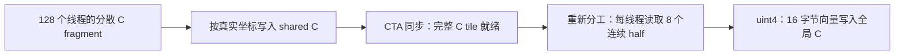
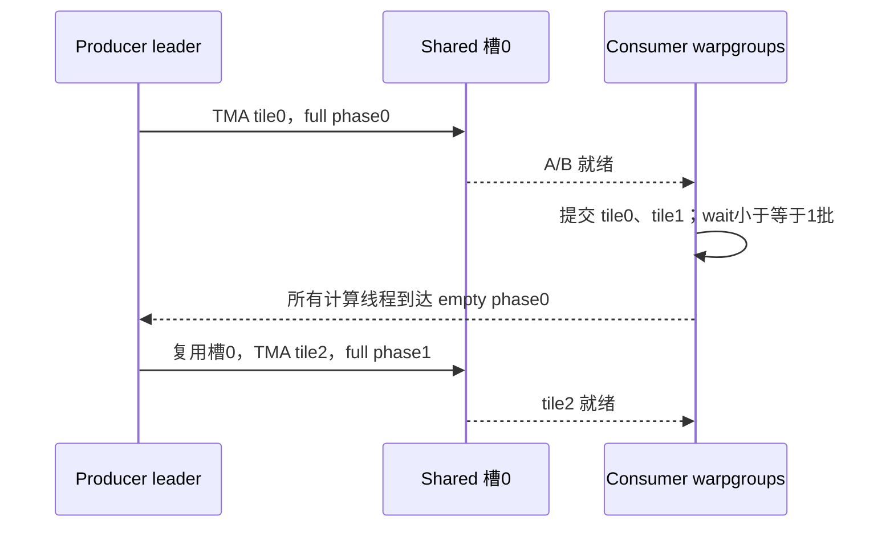
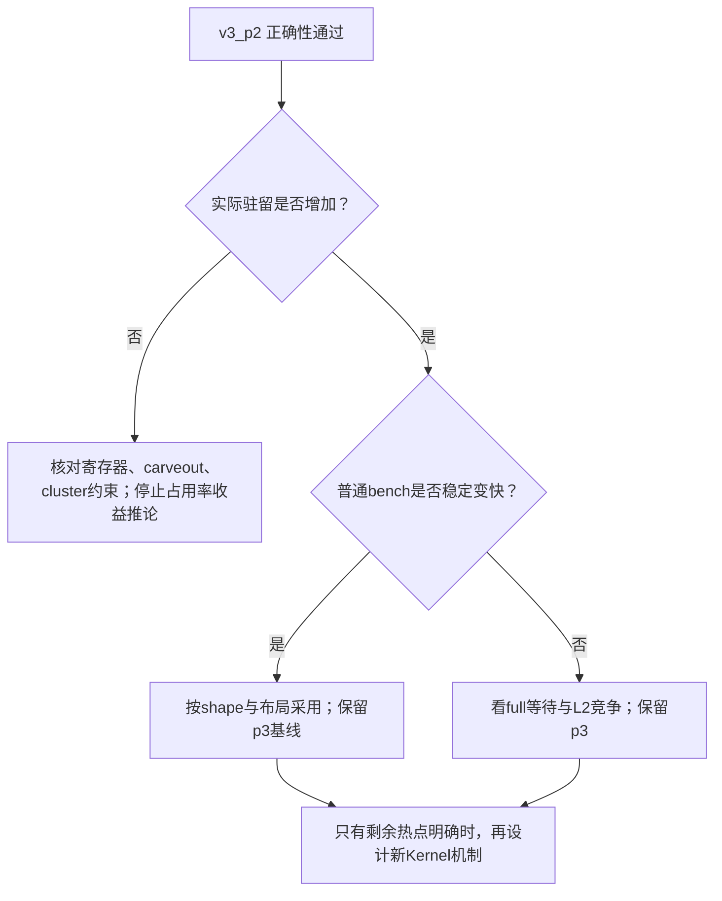

# GEMM Kernel 性能分析与进一步优化方案

## 1. 结论与证据边界

**目前最值得优先验证的方案，是使用现有 `v3_p2` 配置，检验将 v3 的 `PIPE=3` 降为 `PIPE=2`，能否通过增加同一 SM 上驻留的 CTA 来缩短耗时。** 保持 CTA=`128×128×64`、`GMMA_INST_N=128`、两批 WGMMA 在途和合并写回不变。这个方案已经有编译产物，不需要先改写流水线。

选择它的依据有三层：

1. **源码事实**：三槽 A/B 缓冲占 96 KiB，两槽占 64 KiB，未计屏障和对齐。v3 的 C 暂存复用这块空间。
2. **编译事实**：当前 v3 和 v3_p2 都使用 111 个寄存器/线程，没有 spill；三份 128 线程 CTA 的寄存器预算可行。
3. **待验证假设**：H100 上的共享内存限制有望从每 SM 两个 CTA 放宽到三个，更多独立 CTA 可能隐藏 WGMMA 和供数等待。但是，两槽也会减少预取余量，最终收益必须实测。

**不能据此认定 v3_p2 最快，也不能认为 v5 一定优于 v4。** 当前证据不足以给五个版本排出实测名次，更不足以证明当前最优实现已经接近硬件上限。

本文严格区分：

| 标记 | 含义 | 本文中的例子 |
|---|---|---|
| 已确认 | 当前源码、编译日志、反汇编或原始报告直接支持 | v3_p2 的寄存器数为 111；旧 v1 每批执行完成等待 |
| 推断 | 从已确认事实和资源约束推导，尚需运行核对 | v3_p2 具备每 SM 驻留三个 CTA 的资源条件 |
| 假设 | 必须通过对照实验决定是否成立 | 增加 CTA 后，额外延迟隐藏超过少一槽预取的损失 |

本次完成了源码、现有编译产物、旧 NCU 报告和已有 Notion 算力记录的分析，**没有重新运行 Hopper 性能测试**。当前 Windows 终端未发现 `nvcc`、`ncu`、`nvidia-smi`；WSL 启动检查返回 `Wsl/E_ACCESSDENIED`。已有构建元数据记录 CUDA 12.6.85。核对其中 18 个项目源文件的 SHA256，均与当前文件一致，因此这些编译结果可以用于解释当前快照；它们仍不能替代 GPU 数值和性能实测。

## 2. 分析范围与源码索引

分析对象是 `matmul/modular/kernels/` 的 v1–v5。`matmul/tmp/` 是历史独立程序，`matmul/reports-v1/` 是旧程序报告，不能因版本名相同就认定它们等于当前模块化版本。

项目根目录：

```text
/home/myCode/cutlass_study/peak_flops/src/sm90/nsight_compute
Windows 访问：\\wsl$\Ubuntu\home\myCode\cutlass_study\peak_flops\src\sm90\nsight_compute
```

下文完整的 `matmul/...` 路径均相对这个根目录。为避免反复书写长路径，`build/...`、`kernels/...`、`host/...`、`tests/...` 以及单独提到的模块化脚本/说明文档均相对 `matmul/modular/`；旧报告仅写文件名时，相对 `matmul/reports-v1/`。`K1:157–175` 表示索引 K1 文件的对应行。所有设备入口函数均为 `gemm_backend::gemm_device`。

| 索引 | 文件 | 关键位置与作用 |
|---|---|---|
| E1 | `matmul/modular/kernels/wgmma_tma_fp16_v1.cuh` | 9–10：单批在途、直接输出 |
| E2 | `matmul/modular/kernels/wgmma_tma_fp16_pipeline_v2.cuh` | 6–18：在途批数开关 |
| E3 | `matmul/modular/kernels/wgmma_tma_fp16_epilogue_v3.cuh` | 14–24：合并写回开关 |
| E4 | `matmul/modular/kernels/wgmma_tma_fp16_warp_specialized_v4.cuh` | 6–10：128 个计算线程 |
| E5 | `matmul/modular/kernels/wgmma_tma_fp16_multi_warpgroup_v5.cuh` | 6–8：默认 256 个计算线程 |
| K1 | `matmul/modular/kernels/detail/tma_wgmma_device.cuh` | 13–20：共享存储；87–120：初始化与预取；141–203：v1–v3 主循环；209–245：输出 |
| K2 | `matmul/modular/kernels/detail/tma_wgmma_warp_specialized_device.cuh` | 63–100：生产者；105–148：消费者；151–186：输出 |
| A1 | `matmul/modular/kernels/detail/tma_wgmma_adapter.cuh` | `with_prepared_impl`，50–101：布局、TMA、资源及启动；121–127：整除检查 |
| C1 | `matmul/modular/kernels/detail/wgmma_config.cuh` | 12–31：默认参数；60 以后：FP16 WGMMA 类型选择 |
| C2 | `matmul/modular/kernels/detail/warp_specialized_config.cuh` | 14–35：在途数、线程数、M 维分工约束 |
| H1 | `matmul/modular/host/common.cuh` | `GemmProblem`，43–74：逻辑形状与物理索引 |
| H2 | `matmul/modular/host/measurement.cuh` | `BatchTimer::measure` 67–104；预热 147–180；统计 183–225；测量 258–294 |
| H3 | `matmul/modular/host/validation.cuh` | 44–74：16 点抽样检查及容差 |
| T1 | `matmul/modular/tests/full_output_validation.cu` | 19–50：输出归属；68–100：全输出比较；140–148：K tile 边界用例 |
| B1 | `matmul/modular/build.sh` | 93–110：核心与参数对照配置；130–132：编译参数 |
| B2 | `matmul/modular/run.sh` | 315–345：轮换顺序与普通计时；389–421：NCU；后续：Sanitizer |

## 3. 先明确计算和硬件口径

### 3.1 当前实现计算什么

逻辑张量为 A(M,K)、B(N,K)、C(M,N)：

```text
C(m,n) = sum over k of A(m,k) * B(n,k)
```

这是逻辑 B(N,K) 的行点积表达。对照 BLAS 接口时，必须按实际布局构造操作数，不能直接套用 B(K,N) 的地址公式。

- 输入、累加器和输出均为 FP16，使用 `SM90_64xNx16_F16F16F16_SS`，不是常见的 FP32 累加版本。
- `SS` 表示 A/B 从共享内存描述符取操作数；不需要每个线程先把 A/B 全部加载到自己的寄存器。
- 固定 `alpha=1`、`beta=0`，每次覆盖 C。NT/TN 都支持，C 始终为列主序。
- M、N、K 必须分别整除 CTA 的对应维度；当前没有边界 tile 掩码，也没有 split-K。
- 启动使用 `cluster=(1,1,1)`；当前没有跨 CTA 的 TMA multicast 或分布式共享内存复用。

以 M=N=K=4096 为例：NT 的 `A(3,2)` 地址为 `3+2×4096=8195`，TN 为 `3×4096+2=12290`。C(3,2) 始终是元素偏移 8195。相同数学问题在 NT/TN 中有不同的物理连续方向，TMA 和 WGMMA 的 major 必须匹配。

来源：H1:43–74；A1:9–39、58–80、121–127；C1 的 WGMMA 类型选择。

### 3.2 两套默认参数不要混用

直接使用单版本构建入口时，头文件默认 `GMMA_INST_N=64`；`build.sh --suite core` 显式使用 `GMMA_INST_N=128`。两者 CTA 都为 `128×128×64`、默认 PIPE=3，但一份 K tile 的 WGMMA 指令数不同：

```text
指令数 = (CTA_M/64) × (CTA_N/GMMA_INST_N) × (CTA_K/16)
GMMA_INST_N=128：2 × 1 × 4 = 8 条
GMMA_INST_N=64 ：2 × 2 × 4 = 16 条
```

总运算量没有改变。比较不同 GMMA_N 的结果时，不能把差异全部解释成流水线收益。本文资源表和推荐实验统一使用 core 的 GMMA_N=128。

### 3.3 与当前问题有关的 H100 资源

Hopper 的每 SM 资源包括 64K 个 32 位寄存器、最多 64 个活动 warp、最多 228 KiB shared memory；单 CTA 可用 shared 上限为 227 KiB。动态 shared、寄存器、warp 和分配粒度会共同限制驻留，不能只数线程。cluster 启动还应使用对应的 occupancy 查询核对。[NVIDIA Hopper Tuning Guide](https://docs.nvidia.com/cuda/archive/12.6.3/hopper-tuning-guide/index.html#occupancy)

旧报告确认设备 CC=9.0、114 个 SM，但没有完整设备型号、功耗与时钟策略记录。114 SM 与 H100 PCIe 相符，**不能单独证明具体 SKU 和运行配置**。Notion 旧表以 756 TFLOPS 为分母；这只是一项历史记录口径，不能用它直接判断本次源码距实际运行上限还差多少。

## 4. 五个 Kernel：已经解决了哪些问题

### 4.1 总体对照

下表为 core 配置。`PIPE` 是 A/B 共享槽数，`在途批数` 是每个计算 warpgroup 已提交但可能尚未完成的 WGMMA group 数，两者不是同一概念。

| 版本 | CTA 线程构成 | 主循环 | C 写回 | 已解决的问题 | 仍可能付出的代价 |
|---|---|---|---|---|---|
| v1 | 128 计算线程，兼做 TMA 控制 | 多槽预取；每 K tile `wait<0>` | 原 MMA 映射直接写 | TMA 搬运、SW128 布局、跨 K tile 复用 | 频繁排空计算队列；输出标量 store |
| v2 | 同 v1 | 两批在途，`wait<1>` 后释放最旧槽 | 同 v1 | 减少每批计算完全排空，增加 TMA/计算重叠机会 | TMA 控制仍由计算组承担；直接写回仍分散 |
| v3 | 同 v1 | 同 v2 | 寄存器→shared C→16 字节向量输出 | 改善输出 store 粒度和合并 | shared 重排、两次 CTA barrier、可能的 bank 冲突 |
| v4 | 128 producer + 128 consumer | producer 独立推进 K，consumer 执行 WGMMA | 同 v3，全 CTA 协助最终输出 | 将搬运控制与计算分开 | 多一个完整 warpgroup；寄存器与线程成本 |
| v5 | 128 producer + 256 consumer | 两个计算 warpgroup 沿 M 分工 | 覆盖所有 consumer 的结果 | 降低单线程累加器负担，提供独立发射/等待上下文 | 同一 SM 的 Tensor Core 资源仍共享；最慢计算组限制槽位复用 |

### 4.2 v1 不是完全串行

K1:107–120 在计算前已经预取最多 PIPE 个 tile。`load_tile` 为一份 A/B tile 设置总事务字节数，再提交两份 TMA。因此，v1 已经具备异步供数和多槽缓冲。

它的保守点在 K1:157–175：每批 WGMMA 提交后立即 `warpgroup_wait<0>()`，确认本批结束，再由所有计算线程释放槽位，然后提交补充 TMA。同一个 warpgroup 无法在这次等待期间发射下一批 WGMMA。其他槽中的 TMA 仍可能在后台进行，不能描述成整个 GPU 每次都先搬完再计算。

### 4.3 v2：把“等本批”改成“等最旧一批”

`PIPE=3`、K=5×64 时，K1:177–203 的简化过程如下：

```text
预取：TMA0→槽0，TMA1→槽1，TMA2→槽2
提交 WGMMA0
提交 WGMMA1 → wait<1> → 确认0完成 → 释放槽0 → TMA3→槽0
提交 WGMMA2 → wait<1> → 确认1完成 → 释放槽1 → TMA4→槽1
提交 WGMMA3 → wait<1> → 确认2完成
提交 WGMMA4 → wait<1> → 确认3完成
最后 wait<0> → 确认4完成 → 访问累加器并输出
```

`wait<1>` 的保证是最多剩一个最新 group 在途，并非保证最新 group 一定仍在运行。所以这里提供了重叠机会，是否充分重叠要看计算时间、搬运时间和发射开销。不得在旧批完成前覆盖它使用的 shared 槽，也不得在最终 `wait<0>` 前读取全部累加器。[PTX WGMMA wait_group](https://docs.nvidia.com/cuda/archive/12.6.3/parallel-thread-execution/index.html#asynchronous-warpgroup-level-matrix-instructions-wgmma-wait-group)

两个在途 group 也没有将同一 C 的 K 维累加变成彼此无关的计算；它们继续更新同一份输出累加器。

### 4.4 v3：为什么输出需要重排

CuTe 的 C fragment 不是“lane i 写连续第 i 个 C”。本地 CUTLASS 的 `include/cute/atom/mma_traits_sm90_gmma.hpp:434–435` 给出对应布局。warp 0 固定一个 fragment 位置时：

| lane | 输出坐标 (m,n) |
|---|---|
| 0、1、2、3 | (0,0)、(0,2)、(0,4)、(0,6) |
| 4、5、6、7 | (1,0)、(1,2)、(1,4)、(1,6) |
| … | … |
| 28、29、30、31 | (7,0)、(7,2)、(7,4)、(7,6) |

一次每线程写一个 half 的 warp store，共 64 字节有效数据，却分散在四列。每列只写 8 个 half=16 字节，占用一个 32 字节 sector，合计 128 字节 sector 容量。这里描述的是单条请求利用率，不能直接等价为 HBM 写流量翻倍。

v3 的流程（K1:217–238）：



CTA_M=128 时每列有 16 个向量。最终 store 的 lane0–15 写列0的行0–127，lane16–31写列1的行0–127；两段分别连续、对齐，各覆盖 8 个 sector。全 warp 的 512 字节有效数据覆盖 16 个 sector。两列在全局地址上可能相隔较远，但每个片段内部合并良好。

**编译证据**：`build/script_checks/real_disasm/v1.ptx.txt:2396` 起为 `st.global.u16`；同目录 `v3.ptx.txt:2634–2635` 为 `ld.shared.v4.u32` 和 `st.global.v4.u32`；`v3.sass.txt:1199、1233` 可见 `LDS.128`、`STG.E.128`。

这项优化不是免费的。一个默认 CTA 额外经过 32 KiB shared 写、32 KiB shared 读以及两次 CTA barrier；其中寄存器→shared 仍生成大量 `STS.U16`（同目录 `v3.sass.txt:789` 起）。对于短 K，必须单独比较这些开销。

另外，`beta=0` 时 CuTe `axpby` 已有不读取旧 C 的分支。本地 CUTLASS `include/cute/algorithm/axpby.hpp:74–89` 支持这一点。不能把“删除旧 C 读取”当成这里尚未实现的主要优化。

### 4.5 v4：独立 producer 的实际工作

K2:63–100 将物理线程 0–127 留给 producer，但主循环实际只有 thread0 执行等待空槽、设置事务字节数和提交 TMA。consumer 为线程128–255，拥有一个完整、对齐的计算 warpgroup。其余 producer 线程参与必要的 CTA 同步，最终也可协助向量输出。

```text
producer leader：等 empty → 声明 A+B 字节数 → 提交 TMA → 推进下一 tile
                                    ↓ full 完成
consumer WG：   等 full → WGMMA → commit → wait → 到达 empty
```

它消除了计算 warp 亲自执行补充 TMA 控制的要求，但增加 128 个线程。当前没有 `setmaxnreg`，不能把 producer 的逻辑空闲当成零寄存器成本。

### 4.6 v5：两个计算组分同一个输出 tile

CTA=`128×128×64`、GMMA_N=128 时：

```text
                    输出 N = 0..127
WG0：M = 0..63     [ 64×128 累加器 ]  每 K tile 发 4 条 WGMMA
WG1：M = 64..127   [ 64×128 累加器 ]  每 K tile 发 4 条 WGMMA
```

v4 的一个 WG 顺序覆盖两个 M 片段，每 K tile 共 8 条；v5 两个 WG 各发 4 条，合计仍为 8 条。它没有把 CTA 运算量或 Tensor Core 硬件翻倍，也没有把同一个输出元素分给两个 WG 做 split-K。

分工由 A1:65–66 的 `make_tiled_mma(...Layout<Shape<Int<kComputeWarpgroups>,_1,_1>>...)` 决定。v4 每计算线程负责 128 个 half 输出，v5 为 64 个，因此理想累加器下限从 64 个降为 32 个 32 位寄存器；实际总寄存器还包括布局、描述符、地址和流水状态。

A/B 依然按整个 CTA tile 加载。empty barrier 的到达计数为全部计算线程数（K2:70–71、131–146），只有所有计算组完成旧槽使用后，producer 才能覆盖它。任何一个计算组落后，都会延迟整槽复用。

## 5. 同步机制：用两槽、五个 K tile 说明

每个槽有两道屏障：full 表示 A/B 数据可用；empty 表示计算线程不再读它。两者必须分开。

对 v4/v5，PIPE=2、总 K tile=5 时：

| K tile | 槽 | 本轮 full 等待相位 | producer 覆盖前等待的 empty 相位 |
|---:|---:|---:|---|
| 0 | 0 | 0 | 首轮，无须等待 |
| 1 | 1 | 0 | 首轮，无须等待 |
| 2 | 0 | 1 | 0：tile0 已释放 |
| 3 | 1 | 1 | 0：tile1 已释放 |
| 4 | 0 | 0 | 1：tile2 已释放 |

相位只表示同一槽的前后轮次，不是全局 tile 编号。full 等本轮完成，producer 则等上一轮 empty 完成，因此等待相位不能机械地写成相同表达式。对应实现：K2:82–89、117–122。



K2:92–100 的 producer tail 还要等每个已使用槽的最后一次释放。否则，epilogue 复用 shared 时，producer 可能还在读其中的 barrier。两批在途的 consumer 最后也必须 `wait<0>` 并释放最后一槽（K2:142–147）。短 K 不能等待从未使用的槽。

v1–v3 没有独立 producer tail；计算分支结束后，旧批全部完成，且没有独立线程继续推进 TMA。不能把 v4/v5 的 tail 代码直接复制进 v3，而忽略两套线程结构的区别。

## 6. 真实性能证据与不能得出的结论

### 6.1 旧 v1 NCU：有等待和输出事务的具体证据

`matmul/reports-v1/gemm_key_metrics.csv:3` 的签名确认：CTA=`128×128×64`、PIPE=3、GMMA=`64×128×16`、128 线程、grid=`32×32`、MN-major。缺少对应二进制的构建哈希和完整启动记录，不能视为当前 modular v1 的重新测量。

| 旧报告指标 | 值 | 直接说明什么 |
|---|---:|---|
| NCU Duration | 472.736 µs | 被分析的那次内核耗时，不能与普通 bench 成绩混排 |
| Tensor active / elapsed peak | 61.612556% | 该配置的 Tensor 管线尚有空隙；不能直接换算可优化比例 |
| DRAM throughput | 24.670036% | 没有该报告支持“HBM 已饱和” |
| L2 throughput | 66.85% | 不能忽略 L2→SM 供数和缓存行为 |
| SM frequency | 1.01 GHz | 不能直接拿产品峰值频率下的 TFLOPS 作等条件比较 |
| active / eligible warps 每 scheduler | 1.938720 / 0.231919 | 活动 warp 很少，能发射的更少 |
| No Eligible | 78.46% | 大量周期无就绪 warp，但低 issue 本身不等于 Tensor Core 同比例闲置 |
| 寄存器 / 线程 | 116 | 当前表仅适用于这份旧内核 |
| Dynamic shared / CTA | 98.43 KB（报告单位） | 与三槽 96 KiB 数据及屏障、对齐一致 |
| shared 限制的 CTA 上限 | 2 | 共享内存是该次驻留上限的重要因素 |
| theoretical / achieved occupancy | 12.50% / 12.01% | 约 8 / 7.69 个 warp 每 SM |

来源：`gemm_overview.txt:8–16、49–53、74–101`，以及上述 CSV。

WarpState 表的 Stall Barrier=2.96、Stall GMMA=2.39、Long Scoreboard=1.13，是平均每条发射指令间的 warp 周期组成项，**不是百分比**（`gemm_round2_warp.txt:69、80–82`）。更关键的是源码位置归因：

- `gemm_round3_sass.txt:904` 的 `WARPGROUP.DEPBAR.LE gsb0,0x0` 有 15,955 个 all samples，其中 15,879 个落在 stall_barrier 列。这支持每批 WGMMA 完成等待是旧实现的主要热点之一。
- 第一条 `HGMMA.64x128x16.F16` 在同文件:860 也是明显采样热点；全局 warpgroup_arrive 样本为 12,900（`gemm_round3_source_counters.txt:32`）。
- 不能看到 Barrier 就归因于 CTA 的 `__syncthreads()`，更不能直接删同步。

直接写回的合并不足也有原始证据：

```text
Global theoretical sectors = 2,097,152
Global ideal sectors       = 1,048,576
```

见 `gemm_round3_source_counters.txt:62–63`。同一报告 SASS:1226、1233 的 `STG.E.U16` 每条也显示 sectors 为 ideal 的两倍。v3 已针对这一类问题增加输出重排，不能拿旧 v1 的数据断言当前 v3 仍有相同的全局写回问题。

相反，旧报告的 shared excessive wavefronts=0，shared wavefronts 与 ideal 都为 25,165,824（SourceCounters:10、60–61），**没有该报告支持“旧 v1 的主要瓶颈是 shared bank conflict”**。

### 6.2 已有 Notion 算力记录：支持提出假设，不支持五版排名

读取到的历史页面为 [matmul-fp16 算子算力记录](https://app.notion.com/p/3fe2ac10ed7e801e8d80c51546ff2237)。以下保留原记录名称和 TFLOPS：

| 历史名称 | 布局 | PIPE=2 | PIPE=3 |
|---|---|---:|---:|
| fp16-baseline | NT | 385.33 | 437.96 |
| fp16-wgmma-pipeline | NT | 452.05 | 450.17 |
| fp16-epilogue-coalesced | NT | 448.23 | 442.96 |
| fp16-pipeline+epilogue | NT | 476.74 | 458.44 |
| fp16-baseline | TN | 494.68 | 未填 |

其余 TN 对照未填。页面没有完整 shape、GMMA_N、输入、采样、频率、构建哈希或原始日志。仓库 `matmul/run_ncu.sh` 列出若干旧程序的 4096³ NT 抓取命令，但没有证据把上述每一项成绩与这些命令、当前二进制一一绑定。

仅从表内计算，NT 的 pipeline+epilogue 两槽相对三槽高约 3.99%，而 baseline 两槽反而较差。这个历史现象说明“槽越多越快”不成立，值得重新对照；**3.99% 不是当前 v3_p2 的预期提升，也不能外推给 v4/v5**。

当前五版的性能状态应如实填写：

| 当前版本 | 编译资源与反汇编 | CPU 映射产物 | 可比的普通计时 / 新 NCU |
|---|---|---|---|
| v1 | 有 | 有 | 缺失 |
| v2 | 有 | 有 | 缺失 |
| v3 | 有 | 有 | 缺失 |
| v4 | 有 | 有 | 缺失 |
| v5 | 有 | 有 | 缺失 |

`H100_BENCHMARK.md:3` 明确说明该文档提供实验方法，不包含 H100 实测结论。`*.validate.mapping.txt` 的 PASS 证明的是线程覆盖，不是 GPU 全输出运行通过。

## 7. 当前最明确的资源约束

### 7.1 编译日志中的真实寄存器数

来源：`matmul/modular/build/h100_pcie/{配置名}.build.log:86–91`；`build/script_checks/real_disasm/*.resources.txt:36–38` 可交叉核对部分配置。编译实例顺序为 TN（Major::K=0）在前、NT（Major::MN=1）在后。

| 配置 | CTA 总线程 | NT 寄存器/线程 | TN 寄存器/线程 | stack / spill |
|---|---:|---:|---:|---|
| v1 | 128 | 116 | 112 | 0 |
| v2 | 128 | 111 | 111 | 0 |
| v3、v3_p2、v3_p4 | 128 | 111 | 111 | 0 |
| v4、v4_p2、v4_p4 | 256 | 109 | 110 | 0 |
| v5、v5_p2、v5_p4 | 384 | 58 | 60 | 0 |
| v4_m256_t128、v5_m256_t128 | 256 | 240 | 240 | 0 |
| v5_m256_t256 | 384 | 109 | 109 | 0 |
| v5_m256_t512 | 640 | 58 | 58 | 0 |

这些结果不支持“当前已经发生寄存器 spill”的说法。但 240 个寄存器/线程已非常接近单线程资源上限；扩大 tile 不能只看复用增加。

### 7.2 PIPE 改变的是驻留台阶，也改变预取能力

当前 SharedStorage 的数据和屏障大小为：

```text
A+B 数据字节数 = 2 × (CTA_M+CTA_N) × CTA_K × PIPE
barrier 原始字节数 = 16 × PIPE
动态 shared = max(sizeof(SharedStorage), 2×CTA_M×CTA_N)
```

最后一项 C 暂存只在合并写回开启时适用。A/B 与 C 生存期不重叠，不能相加。A1:83–89 使用真实 `sizeof(Storage)`，包括结构对齐；下面的字节数适用于当前默认形状及布局。

| PIPE | A+B 数据 | 含屏障和 128B 结构对齐的动态 shared | 仅按 228 KiB shared 估算的 CTA 上界 |
|---:|---:|---:|---:|
| 2 | 65,536 B | 65,664 B | 3 |
| 3 | 98,304 B | 98,432 B | 2 |
| 4 | 131,072 B | 131,200 B | 1 |

还需考虑每 CTA 的系统保留空间、carveout、寄存器分配粒度和启动约束。这里是资源模型，实际采用 LaunchStats/Occupancy 验证。

v3_p2 的 111 个寄存器/线程，按约 112 的分配粒度估算：

```text
3 CTA × 128线程 × 112寄存器 ≈ 43,008 < 65,536
```

因此具备从 8 个活动 warp/SM 增加至 12 个的条件，即理论 occupancy 12.5%→18.75%。这只是驻留上限增加，不是预期加速 50%。

**v4/v5 不满足同样的推论**。即使先不计分配粒度：

```text
v4 NT：3 × 256 × 109 = 83,712 > 65,536
v5 NT：3 × 384 × 58  = 66,816 > 65,536
v5 TN：3 × 384 × 60  = 69,120 > 65,536
```

所以只将它们改为 PIPE=2，并不能靠 shared 变小就达到三个 CTA。它们仍可能因启动、缓存或供数差异变快/变慢，但必须另找测量证据。

### 7.3 tile 更大也有代价

默认每 K tile 的计算量为 `2×128×128×64=2,097,152 FLOPs`，A+B 输入 32,768 B，CTA 级输入算术强度为 64 FLOPs/B，不含 C 输出和跨 CTA 缓存复用。

将 M 改成256、N/K不变，计算量翻倍，A+B变为49,152 B，输入强度约85.33 FLOPs/B。但 PIPE=3 的数据 shared 变为144 KiB，shared 通常只容一份 CTA；一个计算组的编译寄存器数也升至240。因此不能只按复用更高就判断更快。

global/HBM 层面的算术强度还取决于跨 CTA 的 L2 命中。上述 CTA 输入模型不能代替 HBM roofline，也不能用 DRAM 使用率低排除供数延迟。

## 8. 推荐优先方案：验证 v3 的两槽配置

### 8.1 优化目标与原因

目标是减少单 CTA 为预取占用的 shared，使同 SM 有更多独立计算 CTA，在某 CTA 等 TMA 或 WGMMA 时，让另一 CTA 更有机会继续提交计算。

旧 v1 有明显的 WGMMA 等待和较少 eligible warp；v2/v3 已经用两批在途改进这一问题。接下来不应再重复提出“增加异步流水线”，而应检验现有两批在途是否真的需要三个 shared 槽，以及少一槽是否能换来有价值的驻留提升。

### 8.2 为什么有可能有效，也为什么可能失败

```text
PIPE=3：预取 tile0/1/2
        issue0 → issue1 → 释放0并装tile3
        tile2 已经提前装好，供数余量较大

PIPE=2：预取 tile0/1
        issue0 → issue1 → 释放0并装tile2
        下一轮立即需要tile2，可能等TMA完成
```

若 WGMMA1 的计算时间足够覆盖 TMA2，加上更多 CTA 的调度，PIPE2 可能获益。若搬运延迟更长或多个 CTA 加重供数竞争，PIPE2 可能更频繁等 full barrier，收益被抵消。NT/TN、K 长短和矩阵形状可能有不同结论。

### 8.3 第一轮实现：已有代码即可执行

`B1:101–102` 已有 `v3_p2` 和 `v3_p4`。第一轮直接比较 `v3_p2 / v3 / v3_p4`，**不修改** K1 的 barrier、release_state、final wait 或 C 映射。

单独构建两槽 v3 的等价命令：

```bash
bash build_benchmark.sh --kernel v3 --output build/research/gemm_v3_p2 \
  -- -DPEAK_CTA_M=128 -DPEAK_CTA_N=128 -DPEAK_CTA_K=64 \
     -DGMMA_INST_N=128 -DPIPE=2 \
     -DWGMMA_MAX_INFLIGHT=2 -DEPILOGUE_COALESCED=1 \
     -lineinfo -Xptxas=-v
```

若实测有效，再实施以下小范围工程修改：

| 文件 / 函数 | 修改内容 | 目的 |
|---|---|---|
| `build.sh` 的配置表 | 保留 p3 基线，把实测胜出的 p2 配置作为明确的推荐 ID | 可复现；不将所有版本的全局 PIPE 默认值一并改掉 |
| `tma_wgmma_adapter.cuh::with_prepared_impl` | 在准备阶段记录 kernel 属性、动态 shared、每 SM 活动 block 与活动 cluster 上限 | 让资源模型与实际设备对应，放在计时之外 |
| `README.md`、`H100_BENCHMARK.md` | 写明已验证的 GPU、shape、布局、哈希和选择条件 | 避免把某一布局/尺寸的胜出当通用规则 |
| `run.sh` 的结果记录 | 将选择依据关联到原始 bench、NCU、编译资源目录 | 便于回退和重新验证 |

资源诊断可在 A1 的 `cudaFuncSetAttribute` 之后加入如下逻辑；这是拟议代码，尚未写入 Kernel：

```cpp
cudaFuncAttributes attr{};
int active_blocks = 0;
CUTE_CHECK_ERROR(cudaFuncGetAttributes(&attr, kernel));
CUTE_CHECK_ERROR(cudaOccupancyMaxActiveBlocksPerMultiprocessor(
    &active_blocks, kernel, int(config.block.x), config.smem_bytes));
// 记录 attr.numRegs、attr.sharedSizeBytes、config.smem_bytes、active_blocks。
// 当前按 cluster API 启动，还须构造匹配启动配置，查询
// cudaOccupancyMaxActiveClusters；最终用 NCU 交叉检查。
```

不要仅因“支持 PIPE=2”就改 K1 里的状态更新逻辑；此配置已经通过模板约束并生成代码，首轮实验只改变共享槽数。

### 8.4 预期收益与风险

| 内容 | 可以确认或合理期待的变化 | 仍需验证 |
|---|---|---|
| shared 占用 | 98,432→65,664 B，每 CTA 减少32,768 B | 实际 carveout 和可驻留 CTA |
| 寄存器 | 当前两配置均111，无spill | 换工具链后仍需重新确认 |
| 活动计算上下文 | 资源条件允许2→3 CTA、8→12 warp/SM | achieved occupancy、是否有足够grid |
| 延迟隐藏 | 更多独立CTA可能填补等待空隙 | Tensor利用率、eligible warp、真实耗时 |
| 供数 | 少一槽预取 | full barrier等待是否上升、L2竞争是否加剧 |

不承诺具体 TFLOPS 或百分比。对1024³，默认仅64个 CTA，小于旧报告的114个 SM，增加单 SM 的驻留容量未必有价值；对4096×4096×256，仅四个 K tile，启动、排空和写回占比更大，也不能套用长 K 结论。

验收只接受可重复的普通计时收益：提升超过同环境的重复波动，跨进程 p50 持续更低，正确性通过，目标工作负载的尾部/漂移没有不可接受回退。可预先设定例如2%的工程价值门槛，但它是验收策略，不是收益预测；低于噪声时保留原配置。

## 9. 后续方向按证据推进

### 9.1 第二优先：量化并改进 epilogue 的 shared 重排

K1:219–224、K2:162–167 使用朴素列主序 shared C。按前面的线程映射，CTA_M=128 时：

```text
byte_address = 2 × (m + 128×n)
bank         = floor(byte_address/4) mod 32
lane0..3： (m,n)=(0,0),(0,2),(0,4),(0,6)
地址：       0,      512,    1024,   1536 字节
bank：       0,      0,      0,      0
```

这些是同 bank 的不同32位 word；相邻两行可落在同 word 的两个 half。结合 `STS.U16`，静态模型预测这里有四路冲突风险，**不是八路**。shared 的32个 bank与32位字映射规则见 [CUDA shared memory access patterns](https://docs.nvidia.com/cuda/cuda-programming-guide/02-basics/writing-cuda-kernels.html#shared-memory-access-patterns)。实际冲突数量必须由当前 v3 的 NCU 数据确认，不能挪用旧 v1 的 shared 指标。

若 short K 实测表明此处有显著 excessive wavefront 或 MIO/short-scoreboard 开销，再尝试新的 epilogue：用经过 CuTe 验证的 swizzle 或按32位打包的 fragment 搬运分散 bank，同时保留合并的全局输出。对应修改点是 K1/K2 的 shared C 布局、寄存器到shared复制、向量读取地址，以及 A1 的实际shared大小计算。

**不能只给 sC 加一个 swizzle 就保留当前线性 `smem_C+vec*8` 读取**，因为后者将读错逻辑坐标；也不能随意加padding后继续假设8个half物理连续。必须为两端给出匹配的地址映射，重新验证每个输出恰好被写一次，再看 shared事务是否真正减少。

### 9.2 v4/v5 的寄存器再分配有根据，但不是首轮方案

没有 `setmaxnreg`、producer工作量很小，而静态寄存器上限按整个 Kernel 形成资源成本，这是值得研究的事实。可在第二轮设计 consumer/producer 不同寄存器预算，优先用 CUTLASS 对应的 warpgroup 寄存器分配接口。

但指令要求整个128线程warpgroup一致执行，预算在同一CTA内重新分配，`.inc` 可能等待可用寄存器。必须连同编译时预算、分支处寄存器存活期、producer尾部和协助输出的寄存器需求一起设计。仅加一条 `.dec` 不能保证全SM能多驻留一个CTA。[PTX setmaxnreg](https://docs.nvidia.com/cuda/archive/12.6.3/parallel-thread-execution/index.html#miscellaneous-instructions-setmaxnreg)

另一个候选是减少producer线程，但不能仅把前置producer数量从128改成32，否则consumer不再从物理128线程边界开始。若做此实验，须重新安排为计算组从对齐位置开始、producer放尾部，并修改线程映射、总线程数和epilogue循环。这比已有p2对照更容易引入错误，当前没有证据证明值得优先。

### 9.3 其他方向暂不优先

| 方向 | 暂不优先的具体原因 | 升级为实验的条件 |
|---|---|---|
| 增加到更多WGMMA在途批 | 当前仅支持1/2；会改变释放队列、尾部和所需槽数 | 当前消费者仍显著受计算提交/完成等待限制且有资源余量 |
| 扩大CTA/增加计算WG | 已有256×128参数对照，shared与寄存器可能压低驻留 | 固定tile的线程对照显示收益，资源和时序解释一致 |
| TMA store输出 | 当前已使用16字节输出；TMA store还需描述符、异步可见性与完成等待 | epilogue占比明确高，能抵消新增固定成本 |
| cluster multicast | 目前cluster=1；需跨CTA任务配合与新同步 | 大问题中重复A/B供数/L2带宽成为实测限制 |
| persistent / CTA调度重排 | 目前静态2D grid，没有证据表明调度是主要限制 | 多波次长K测试显示尾部或跨CTA缓存复用问题 |
| split-K | 改变归约与数值路径，通常引入额外写回 | M/N小、K很大、现有grid严重不足且归约成本可接受 |

## 10. 可直接执行的验证方案

以下命令在具备 Hopper、CUDA、CUTLASS、NCU 的 Linux/Bash 中执行。它们是下一轮实验命令，本文没有声称已经执行成功。每次使用新结果目录，保留已有记录。

### 10.1 构建和保存环境

```bash
cd /home/myCode/cutlass_study/peak_flops/src/sm90/nsight_compute/matmul/modular
export CUTLASS_ROOT=/home/myCode/cutlass_study/peak_flops/third_party/cutlass
export CUDACXX=/usr/local/cuda-12.6/bin/nvcc
export PATH="$(dirname "$CUDACXX"):$PATH"
GPU=0
BUILD_DIR="$PWD/build/h100_pcie"
EXP_DIR="$PWD/reports/research_$(date +%Y%m%d_%H%M%S)_$$"

bash build.sh --suite all --with-validation \
  --cutlass "$CUTLASS_ROOT" --nvcc "$CUDACXX" --output-dir "$BUILD_DIR"
bash run.sh --mode env --gpu "$GPU" --output-dir "$EXP_DIR/env"
bash run.sh --mode disasm --build-dir "$BUILD_DIR" \
  --variants v1,v2,v3,v4,v5,v3_p2,v3_p4 --output-dir "$EXP_DIR/disasm"
```

核对真实GPU型号、SM数、MIG/ECC、驱动、CUDA/CUTLASS版本、源码哈希、功耗上限、时钟、温度、限制原因及其他进程。无需先改系统时钟或功耗；比较时保持策略一致并记录实际观测值。

### 10.2 正确性先于计时

```bash
bash run.sh --mode validate --build-dir "$BUILD_DIR" --gpu "$GPU" \
  --variants all --output-dir "$EXP_DIR/validate"

bash run.sh --mode sanitize --build-dir "$BUILD_DIR" --gpu "$GPU" \
  --variants v3_p2,v3 --layouts NT,TN --output-dir "$EXP_DIR/sanitize"
```

T1 中的全输出测试先将 C 填 NaN，检查真实CuTe线程归属，重复启动并逐元素比较；覆盖 NT/TN、四种输入和 `1、2、PIPE-1、PIPE、PIPE+1、3*PIPE+1` 个K tile，去掉重复与0。它把参考部分和限制在FP16可精确表示的整数范围，适合发现错位、漏写、覆盖和环形相位错误。

主benchmark的PASS仅包含全输出finite/checksum和16个点的参考检查，容差 `1+0.02×abs(reference)`（H3:44–74）。它不能替代全矩阵验证。大K和任意浮点输入还需独立精度测试；与cuBLAS/CUTLASS比较时必须匹配累加精度、布局、alpha/beta及输出类型，不要求FP16累加与FP32累加逐位相等。

Sanitizer需支持Hopper TMA/WGMMA语义。其通过是辅助证据，仍需保留屏障状态证明与数值测试；其耗时不能用于性能排名。

### 10.3 补齐五版普通计时

```bash
bash run.sh --mode bench --build-dir "$BUILD_DIR" --gpu "$GPU" \
  --variants v1,v2,v3,v4,v5 --baseline v1 --layouts NT,TN \
  --shapes 1024x1024x1024,4096x4096x4096,8192x8192x8192,4096x4096x256,16384x1024x4096,1024x16384x4096 \
  --repeats 5 --per-batch 20 --min-warmup 300 --batches 100 \
  --output-dir "$EXP_DIR/core"

bash run.sh --mode bench --build-dir "$BUILD_DIR" --gpu "$GPU" \
  --variants v3_p2,v3,v3_p4 --baseline v3 --layouts NT,TN \
  --shapes 4096x4096x4096,8192x8192x8192,4096x4096x256 \
  --repeats 6 --per-batch 20 --min-warmup 300 --batches 100 \
  --output-dir "$EXP_DIR/v3_pipe"
```

`run.sh` 已按重复轮次循环移位测试顺序，降低温度/boost漂移与版本顺序的相关性。首轮结论明确后，再跑v4/v5的p2/p3/p4、固定256×128tile的128/256/512计算线程对照；不要同时改变tile、PIPE和线程数后只归因于一个因素。

测量口径：

- 单样本是20次启动总Event时间除以20；p50/p99是这些批均延迟的百分位，**不是单次Kernel延迟分布的p99**。
- FLOPs=`2MNK`，TFLOPS=`2MNK/(latency_ms×10^9)`；报告每个问题、布局的耗时和TFLOPS，不只给全局平均值。
- 输入生成、描述符构造、Host↔Device、CPU校验在正式计时外；Event仍可能包含CPU提交不及时留下的GPU空隙。小问题应补Nsight Systems时间线检查，不能把提交空隙当Kernel计算瓶颈。
- 检查warmup是否进入平台、批次漂移、跨进程p50范围与telemetry；`summary.csv`的flagged runs需逐条解释。
- 当前重复使用同一A/B/C，是显存常驻的重复运行场景，可能命中L2；若业务要求冷数据，应另定义实验，不能混成同一成绩。

### 10.4 NCU抓取与缓存口径

```bash
bash run.sh --mode ncu --build-dir "$BUILD_DIR" --gpu "$GPU" \
  --variants v1,v2,v3,v4,v5 --layouts NT,TN \
  --profile-shape 4096x4096x4096 --ncu-set focused \
  --ncu-cache cold --ncu-clock none --launch-skip 50 \
  --output-dir "$EXP_DIR/ncu_core"

bash run.sh --mode ncu --build-dir "$BUILD_DIR" --gpu "$GPU" \
  --variants v3_p2,v3,v3_p4 --layouts NT,TN \
  --profile-shape 4096x4096x4096 --ncu-set focused \
  --ncu-cache cold --ncu-clock none --launch-skip 50 \
  --output-dir "$EXP_DIR/ncu_v3_pipe_cold"

bash run.sh --mode ncu --build-dir "$BUILD_DIR" --gpu "$GPU" \
  --variants v3_p2,v3 --layouts NT,TN \
  --profile-shape 4096x4096x4096 --ncu-set focused \
  --ncu-cache warm --ncu-clock none --launch-skip 50 \
  --output-dir "$EXP_DIR/ncu_v3_pipe_warm"
```

脚本的cold为kernel replay并每pass清cache，warm为application replay且不清cache；后者通过重建应用历史比较热缓存行为。两者设置应在所比较配置间保持一致。NCU replay、采集和cache控制会改变观测条件，**正式性能排名只取普通bench**。[Nsight Compute Cache Control](https://docs.nvidia.com/nsight-compute/ProfilingGuide/index.html#cache-control)

### 10.5 指标必须回答具体问题

先用环境记录中的 `--list-sections`、`--query-metrics` 确认本机支持项。focused已包括LaunchStats、Occupancy、SpeedOfLight、ComputeWorkloadAnalysis、MemoryWorkloadAnalysis、SchedulerStats、WarpStateStats、InstructionStats、SourceCounters。不同NCU版本的细分TMA/GMMA指标可能变化，不把网上某个计数器名称当通用接口。

| 要验证的问题 | Section / 指标 | 支持方案的变化 | 反对方案的证据 |
|---|---|---|---|
| 是否真的多驻留CTA | LaunchStats、Occupancy；寄存器、dynamic shared、block limits | v3 p2驻留上限2→3，实占用相应提高 | carveout/其他限制使CTA数未增加 |
| 是否提高有效计算 | `sm__pipe_tensor_cycles_active.avg.pct_of_peak_sustained_elapsed` | 同问题下Tensor活跃提高且bench耗时下降 | 占用增加但Tensor活跃下降 |
| 是否更有就绪线程 | `smsp__warps_eligible.avg.per_cycle_active`、`smsp__issue_active.avg.pct_of_peak_sustained_active` | 就绪/发射改善，与耗时一致 | 仅producer或无效控制指令增加 |
| 是否减少等待空隙 | WarpStateStats、SourceCounters、对应SASS PC | consumer的full等待和WGMMA等待占比更合理 | full等待明显增多，少一槽供数不足 |
| 是否受HBM/L2限制 | DRAM/L2字节、吞吐、命中率；`gpu__dram_throughput.avg.pct_of_peak_sustained_elapsed` | 流量可解释，未因多CTA供数恶化 | L2/DRAM竞争增加并造成回退 |
| 输出重排是否值得 | global sectors/request、actual/ideal、`STG.E.128` | v3相对v2减少输出事务且净耗时下降 | shared重排/同步抵消了global收益 |
| shared重排是否冲突 | shared bank conflicts、actual/ideal wavefronts、`STS.U16`位置 | 优化后excessive wavefront减少 | 只改布局却引入额外指令或错误映射 |
| 是否产生spill | ptxas spill、local load/store与对应SASS | 无spill、无异常local流量 | 为提高occupancy压寄存器后产生spill |

`gpu__time_duration.sum` 可用于NCU内部同条件诊断；不要将它混入普通Event成绩。`smsp__warps_active.avg.per_cycle_active` 也不能单独作为成功指标。

v4/v5要按producer/consumer指令位置分别解释等待。producer等empty往往表示消费者尚在计算，不能简单认定“producer stall越少越好”。Warp采样是统计信息，样本数量和热点应结合源位置、运行时长和采样设置解释，不把一次采样比例当精确时间分解。[Nsight Compute Warp Sampling](https://docs.nvidia.com/nsight-compute/ProfilingGuide/index.html#warp-sampling)

## 11. 实施顺序、决策规则与停止条件

| 阶段 | 交付物 | 继续条件 |
|---|---|---|
| 1. 固化快照 | 源码哈希、manifest、编译资源、设备与环境记录 | 确认测试的是同一语义、同一构建配置 |
| 2. 数值与同步验证 | 全输出、短K/回绕用例、Sanitizer记录 | 无漏写、错位、竞态或死锁 |
| 3. 五版基线 | 各shape/布局普通计时、重复范围、telemetry | 得到当前真实排序，识别异常结果 |
| 4. v3三种PIPE | p2/p3/p4普通计时与NCU | 证明资源变化是否带来净收益 |
| 5. 小范围采用 | 推荐配置、适用范围、原始证据链接、回退基线 | 超过噪声与预定工程价值门槛 |
| 6. 有条件深入 | epilogue或producer寄存器实验 | 当前NCU明确指向该问题，且预计价值值得复杂度 |

判断两槽方案的结果时：



若同精度、同布局的可信参考实现和当前最佳配置都已在目标shape下达到接近的稳定性能，Tensor路径持续利用充分，供数没有明显浪费，且剩余主要是不可避免的尾部/启动成本，则继续改写复杂状态机的价值可能很低。应依据重复性和业务规模决定停止，而不是为了推出v6而增加复杂度。

目前尚缺少这些条件，因此合理结论是：**有明确、成本低的优化假设值得验证，但还没有证据确定最佳版本或承诺性能提升。**

## 12. 需要补齐的数据与复现记录模板

优先缺失项按顺序为：当前v1–v5的普通计时、v3 p2/p3/p4的资源与NCU、完整GPU与频率/功耗条件、目标业务shape及冷热缓存要求、同精度参考实现。v4/v5的细分producer/consumer等待和epilogue占比决定下一步是否值得改代码。

| 字段 | 每次实验应填写 |
|---|---|
| 设备 | 完整型号、UUID、SM数、MIG/ECC、驱动 |
| 构建 | CUDA/CUTLASS版本、源哈希、完整命令、GMMA_N、CTA、PIPE、线程数、在途批数、epilogue开关 |
| 资源 | registers/thread、spill、dynamic shared、active block/cluster上限 |
| 问题 | M/N/K、NT/TN、输入模式、精度、alpha/beta |
| 正确性 | 映射、全输出、小K与回绕用例、Sanitizer、长K误差结果 |
| 普通性能 | warmup、每批次数、批数、重复次数、各进程p50/p99、跨进程范围、漂移 |
| NCU | 版本、cache/replay/clock设置、目标启动序号、Tensor/供数/等待/输出/shared指标 |
| 环境 | 实测频率、温度、功耗与限制原因、其他进程 |
| 决策 | 收益是否超过噪声、适用shape/布局、回退配置、原始日志位置 |

## 13. 同步审计补充

K1:91–98 初始化barrier后调用 `cluster_sync()`；K2:67–75 显式调用 `fence_barrier_init()` 后CTA同步。两条路径不完全相同。本地 CUTLASS `include/cute/arch/cluster_sm90.hpp:57–79` 和 `include/cutlass/arch/barrier.h:706–719` 可追溯相关实现。

这是需要按实际PTX内存模型继续核查的正确性审计项，本文没有将它认定为已复现缺陷，也没有将增加fence当作性能提升方案。若后续调整初始化发布方式，应分别保存正确性结果与性能结果，避免把同步语义变化混入PIPE对照。尤其不要把“过去测过没错”当作任意删除fence或barrier的依据。

## 14. 资料来源与交付说明

主要结论来自本文第2节索引的当前源码、`build/h100_pcie/` 的真实编译日志/映射产物、`build/script_checks/real_disasm/` 的PTX/SASS，以及第6节逐项注明的旧NCU和Notion记录。外部资料仅用于核对硬件与指令语义，已在相关段落链接NVIDIA官方文档。

本文是技术分析与可执行实验方案，未修改五个Kernel，也未产生新的性能成绩。按本次对目标位置的确认，Notion交付位置为「matmul 算子调试记录」下的新子页面；不覆盖已有笔记。Markdown保留为本地文件，Notion版本保留标题层级、代码块、表格和Mermaid图解。
