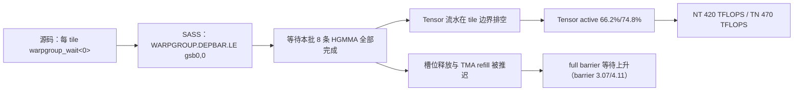
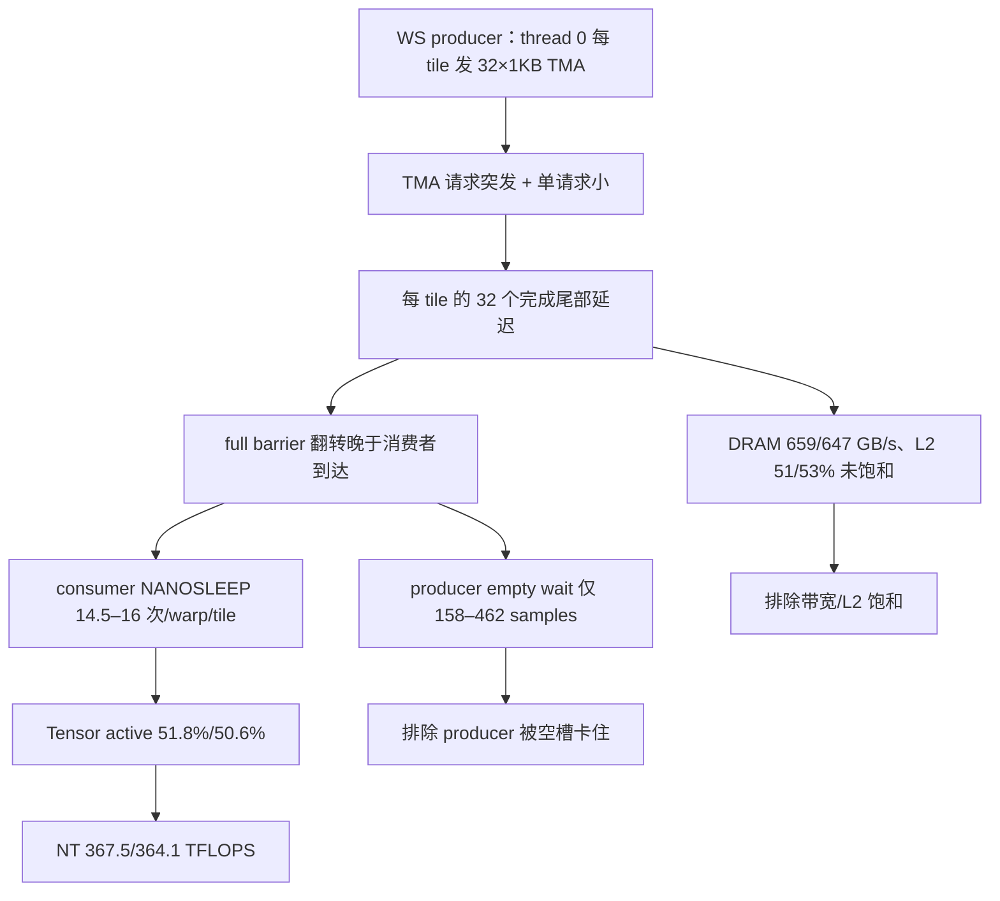

# 07 · 关键性能瓶颈与根因总结

> 本页把 V1–V5 的现象收敛为 7 条根因，并明确 **已证实 / 较高可能性 / 待验证** 三档。每条根因都给出：现象 → NCU → SASS/PTX → 源码 → 硬件机制 → 修复方向。
>
> 结论先行：**五个 kernel 的性能上限不是 DRAM，也不是 L2，而是“TMA 交付节奏 → WGMMA 批次可用性”这条供给链；V1 断在批次串行，V4/V5 NT 断在 WS 与细粒度 TMA 的交互，V3 的写回优化打在了非瓶颈上。**

---

## 1. 根因总表

| ID | 根因 | 主要影响 | 证据等级 | 修复方向 |
|---|---|---|---|---|
| **R-01** | 每 tile `warpgroup_wait<0>` 把 WGMMA 批次串行化 | V1：Tensor 66–75%，NT 420 TFLOPS | **已证实** | inflight=2（V2） |
| **R-02** | V4/V5 NT 的消费者被 TMA 交付饥饿 | V4 NT 51.8% Tensor、−23.2%；V5 NT 50.6% | **已证实（现象）**；机制**较高可能性** | NT 回退 V3；改造 TMA 发射 |
| **R-03** | NT 的 TMA 粒度为 1 KB ×32/tile（TN 为 16 KB ×2） | NT 请求数 16×；V4 NT 崩溃的结构条件 | **已证实（结构）**；定量贡献**待验证** | 更大 box / 预转置 / 并行发射 |
| **R-04** | PIPE 与 occupancy 被 SMEM/寄存器共同锁死 | PIPE=2 只对 V3 有效；V4/V5 PIPE=2 反而更慢 | **已证实** | 按 K 选 PIPE；V5 降到 ≤56 regs |
| **R-05** | C 写回 16-bit 标量导致 2× L2 sector | V1/V2 excessive 1,048,576 | **已证实**，但**非主因** | 合并写回（V3） |
| **R-06** | 合并写回的 SMEM 往返 + 两次 barrier 在短 K 有固定开销 | K=256 V3 −2.3%/−3.7% | **已证实** | 短 K 用 V2；向量化 STS |
| **R-07** | 4096³ PIPE/M256 benchmark 被外部进程污染 | 绝对 TFLOPS 膨胀 1.8–2.0× | **已证实（数据质量）** | 重跑 + telemetry |

---

## 2. R-01：V1 的批次串行（已证实）

### 2.1 因果链

### 2.2 证据

| 层 | 证据 |
|---|---|
| NCU | Tensor 66.23/74.77%；barrier 3.07/4.11；gmma 2.41/0.50；eligible 0.22/0.20；DRAM 37.9/44.5% |
| SASS | `WARPGROUP.DEPBAR.LE gsb0,0x0` @0x…5090（V1-TN），16,528 samples，262,144 次执行 |
| 源码 | `tma_wgmma_device.cuh:167` `warpgroup_wait<0>()`；`:171` 释放；`:174` refill |
| 机制 | 单批次在途；批次间无重叠；SMEM 释放晚于必要时间 |
| 对照 | V2 改 `wait<1>` 后 barrier 3.07→0.10，NT Tensor 66.2→76.4%，benchmark +14.2% |

**判定**：正确性依赖保留（accumulator 不能在批次完成前复用），但“每批等到 0”是过度同步；V2 的 `wait<1>` 在不违反依赖的前提下恢复重叠。

---

## 3. R-02：V4/V5 NT 的消费者饥饿（现象已证实）

### 3.1 因果链

### 3.2 已证实与未证实

| 结论 | 证据 | 等级 |
|---|---|---|
| 消费者在 full barrier 上等数据 | NANOSLEEP 3.81M/8.42M 次；barrier 6.52/5.75；Tensor 51.8/50.6% | **已证实** |
| producer 没有卡在 empty barrier | empty wait 158（V4 NT）/462（V4 TN）samples；UTMALDG 每 PC 65,536 次 | **已证实** |
| 不是 DRAM/L2/TMA 指令管线饱和 | DRAM 32%、L2 51%、TMA pipe 6.47%、L1TEX 24.77% | **已证实** |
| NT/TN 分化由 TMA 请求数造成 | 同代码 NT 51.8% vs TN 78.1%；32 vs 2 atom/tile | **已证实（相关）** |
| 单线程突发发射放大完成尾部 | 消费者 14.5 次自旋 vs V2 1 次；producer 不受限；V2 同 atom 数仍 76% | **较高可能性** |
| 队列深度/请求率是精确主因 | 缺 TMA 延迟/队列计数器 | **待验证** |
| per-atom ELECT 是主因 | ELECT 2,097,152 vs 4,096；但绝对指令占比小 | **待验证（次要）** |

### 3.3 为什么不是“Warp Specialization 一定重叠”

V4/V5 的 producer 确实与 consumer 并行运行，但“并行”不等于“供给充足”。消费者仍然要等每个 tile 的 full barrier；当 TMA 完成尾部超过 3-stage 的覆盖能力时，WS 只是把等待从“生产者自己”转移给了“消费者”。TN 因为每 tile 只有 2 个 16 KB 请求，尾部短，WS 才表现为中性偏正。

---

## 4. R-03：NT 的 TMA 粒度（结构已证实）

| 项目 | NT | TN | 证据 |
|---|---|---|---|
| TMA atom | 1 KB（64×8） | 16 KB（64×128） | kernel 名 `Copy_Traits<...,C<8192>>` vs `C<131072>` |
| atom / operand tile | 16 | 1 | `tma_wgmma_adapter.cuh:77-78` |
| UTMALDG / k-tile / CTA | 32 | 2 | SASS 计数 |
| 总 UTMALDG | 2,097,152 | 131,072 | source CSV |
| `l1tex__tmain_requests` | 3.80–4.39% | 0.27% | NCU |
| V1-NT vs V1-TN Tensor | 66.2% | 74.8% | NCU |
| V2-NT vs V2-TN Tensor | 76.4% | 75.2% | NCU |
| V4-NT vs V4-TN Tensor | **51.8%** | **78.1%** | NCU |

**关键判断**：粒度本身是**已证实**的结构差异，但它对性能的贡献**依赖于调度**：

- V2/V3 用同样的 32 atom，NT 仍达 76–77%，说明 1 KB atom 在“平滑发射”下可被 3-stage + 2 CTAs 覆盖；
- V4/V5 把发射变成单线程突发，NT 崩到 50–52%，TN 不受影响；
- 所以不能简单说“1 KB atom 一定慢”；正确表述是“**1 KB atom + 突发发射 + 3-stage 的组合**在 NT 上不可持续”。

> 1 KB vs 16 KB 的完整推导、WS 与非 WS 的 2×2 对照，以及“粒度是必要但不充分条件”的论证，见 [10 · 专题](10-专题-NT布局TMA粒度与WS交互.md)。

---

## 5. R-04：PIPE/occupancy 的联合约束（已证实）

| 版本 | block | regs | PIPE=2 SMEM | `limit_registers` | `limit_shared_mem` (PIPE=2) | 实际 CTAs | PIPE=2 结果 |
|---|---:|---:|---:|---:|---:|---:|---|
| V3 | 128 | 111 | 65,664 B | 4 | 3 | **3** | **+13–16%**（K=256） |
| V4 | 256 | 109 | 65,664 B | **2** | 2 | 2 | −4% ~ −10% |
| V5 | 384 | 58 | 65,664 B | **2** | 2 | 2 | −3% ~ −10% |

- V3：3 CTAs 的并行度收益 > 少一个 stage 的损失；
- V4：109×256×3 = 83,712 > 65,536，寄存器锁 2 CTAs；
- V5：58×384×3 = 66,816 > 65,536，**只差 1,280 个寄存器**就能 3 CTAs；但 PIPE=3 的 SMEM 又限制 2，所以必须同时 PIPE=2 + ≤56 regs。

**结论**：PIPE 不是独立调优项；它必须与 CTA 数、寄存器、SMEM 一起看。**“stage 越多越好”与“PIPE=2 更好”都是错的**，正确说法是“在给定 occupancy 目标下选最小可行 stage”。

---

## 6. R-05 / R-06：写回与短 K（已证实，非主因）

| 根因 | 证据 | 影响 | 判断 |
|---|---|---|---|
| R-05 16-bit 标量写 → 2× sector | `STG.E.U16` 524,288；sectors 2,097,152 vs ideal 1,048,576；excessive 1,048,576 | C 占 ~3% 流量；V3 修复后 TFLOPS 持平 | **已证实但非瓶颈** |
| R-06 合并写回的固定开销 | STS.U16 524,288；shared excessive 1,572,864（6%）；BAR.SYNC 8,192；K=256 −2.3%/−3.7% | 短 K 可见，长 K 被摊薄 | **已证实** |

**不要**因为 Excessive Sectors 高就直接优化 C 写回；也不要因为 V3 修了 sector 就期待大 K 提升。

---

## 7. R-07：基准污染（数据质量，已证实）

| 数据 | 干净值 | 污染值 | 膨胀 |
|---|---:|---:|---:|
| V3 NT 4096³ | 0.28736 ms / 478.3 TFLOPS | 0.52099 ms / 263.8 | 1.81× |
| V4 NT 4096³ | 0.373979 ms / 367.5 | 0.749218 ms / 183.4 | 2.00× |
| V5 NT 4096³ | 0.377526 ms / 364.1 | 0.750639 ms / 183.1 | 1.99× |

外部 `./test` 进程约 450 MiB。**PIPE/M256 的 4096³ 绝对 TFLOPS 全部弃用**；K=256 同批数据干净，保留。任何基于污染值的“PIPE=2 在 4096³ 更好/更差”的结论都无效。

---

## 8. 不是根因的指标（常见误判）

| 误判 | 为什么不对 | 反例 |
|---|---|---|
| “barrier stall 高 = 同步写错” | barrier 也包含空闲 producer warp 的 epilogue 等待；且 2 CTAs 可交错 | V4 TN barrier 7.55 但 Tensor 78.1% |
| “occupancy 高 = 更快” | 多出的 producer warp 不可发射；真正 consumer 数未增 | V4/V5 occupancy 23–37%，NT 反而更慢 |
| “WS = TMA/计算重叠” | 重叠存在，但供给不足时消费者仍饥饿 | V4 NT 51.8% |
| “stage 越多越好” | 增加 stage 降低 CTAs/SM；短 K 反而更慢 | V3 PIPE=4 1 CTA，−20% |
| “Excessive Sectors 高 = C 写回是瓶颈” | C 只占 3%；修了也不涨 | V3 sector 减半，TFLOPS 持平 |
| “DRAM 没满 = 没问题” | 供给链可在 DRAM 未饱和时断在 TMA/barrier | V4 NT DRAM 32% |
| “warp stall 采样占比 = 时间占比” | 采样受活跃 warp 数/PC 合并影响 | V4 BSSY 36% 是空闲 warp |

---

## 9. 结论的置信度审计

| 结论 | 支撑 | 反证/缺口 | 等级 |
|---|---|---|---|
| V1 的 wait<0> 是主要上限 | Tensor、DEPBAR、V2 单变量对照 | 无 | **已证实** |
| V2 的 inflight=2 对 NT 有效 | +14.2%，bank 内 3 次重复 | TN 几乎不变（已解释） | **已证实** |
| V3 写回对大 K 中性 | sectors 减半 + TFLOPS 持平 + K=256 回归 | 无 | **已证实** |
| V4 NT 消费者被 TMA 饥饿 | NANOSLEEP、producer wait、带宽排除 | 缺 TMA 延迟计数器 | **已证实（现象）** |
| 突发发射是 V4 NT 主因 | V2 同 atom 数仍 76%；V4 TN 不受影响 | 需 producer 改造 ablation | **较高可能性** |
| per-atom ELECT 是主因 | 指令计数差异 | 绝对占比小，未隔离 | **待验证** |
| V5 降 regs 到 56 + PIPE=2 能 3 CTAs | 66,816 vs 65,536 的算术 | 未实测、可能 spill | **待验证** |
| NT 应用 V3、TN 应用 V4 | 多 shape benchmark 一致 | 8192³ 不稳定 | **已证实（当前数据）** |

---

## 10. 如果只能改三处

1. **NT 调度回退 V3**（`tma_wgmma_adapter.cuh` 的 dispatch / 基准脚本选择 V3）——立即恢复 478 TFLOPS。
2. **V4 producer 发射结构**（`tma_wgmma_warp_specialized_device.cuh:79-90`）——4 warp 并行 / election 外提，目标是 NT 的 TMA 完成尾部。
3. **V5 寄存器/ PIPE**（`warp_specialized_config.cuh` + `wgmma_config.cuh:16-17`）——≤56 regs + PIPE=2，争取 3 CTAs/SM。

三处的详细方案、风险与验证见 [08](08-Kernel优化方案与优先级.md) 与 [09](09-后续实验与NCU验证计划.md)。
