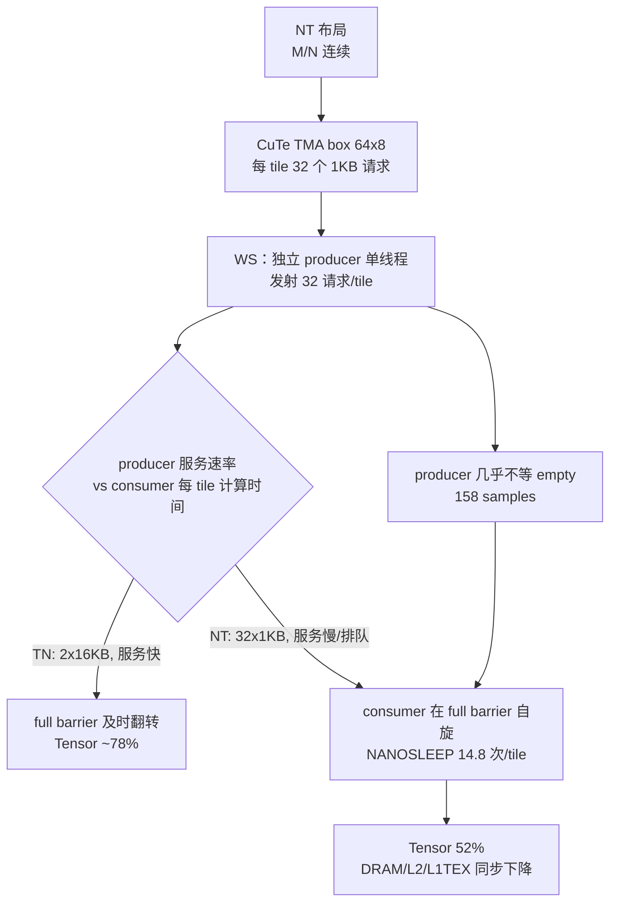

# 10 · 专题：NT 布局的 TMA 粒度与 Warp Specialization 交互

> 本文回答一个跨版本的核心疑问：**为什么同一个 TMA 粒度在 V2/V3（非 WS）上不构成瓶颈，却在 V4/V5（WS）上让 NT 布局损失约 25 个百分点 Tensor 利用率？** 结论分两层：TMA 粒度是必要的结构条件，但**不是充分条件**；真正的触发因素是 producer 与 consumer 解耦后，32 个 1 KB 请求的发射/服务节奏与消费者每 tile 计算时间失配。
>
> 关联：[04 · V4](04-Kernel-V4-性能分析.md)、[05 · V5](05-Kernel-V5-性能分析.md)、[07 · 根因](07-关键性能瓶颈与根因总结.md) R-02/R-03、[08 · 优化](08-Kernel优化方案与优先级.md) OPT-02/OPT-03、[09 · 实验](09-后续实验与NCU验证计划.md) EXP-02/03/07/10/11。

---

## 1. 结论摘要

| 结论 | 证据等级 | 关键证据 |
|---|---|---|
| NT 的 TMA 原子是 **1 KB**，每 k-tile 32 条 UTMALDG；TN 是 **16 KB**，每 k-tile 2 条 | **已证实（结构）** | SASS 计数：NT `UTMALDG=2,097,152`、TN `=131,072`；每 tile 分别为 32 / 2；k-tile 数 = 64，CTA 数 = 1024 |
| 1 KB 粒度**单独不足以**导致性能崩溃 | **已证实** | V2/V3 非 WS 使用完全相同的 32 条请求，NT Tensor 76–77%，与 TN 持平 |
| WS 在 TN（2 请求/tile）上正常重叠 | **已证实** | V4 TN Tensor 78.13%、duration 271.33 µs，与 V3 TN 77.18%/275.49 µs 同级 |
| WS + NT（32 请求/tile）出现消费者饥饿 | **已证实（现象）** | V4 NT Tensor 51.78%，consumer NANOSLEEP 3,881,297；V4 TN 仅 336,923 |
| 饥饿的机制是“单 producer lane 突发/调度失配” | **较高可能性，未证实** | producer empty wait 仅 158 samples（未被空间限制），consumer 每 tile 自旋 14.5 次（V2 约 1 次）；直接区分需 EXP-02/07/11 |
| 请求粒度是定量主因之一 | **待验证** | 需 EXP-03 的预转置/大 box 端到端实验 |

**一句话**：NT 布局把每 tile 的 TMA 工作切成 32 个 1 KB 请求；非 WS 时这些请求由参与计算的 warp 顺带发出，节奏被计算自然限制，TMA 能在下一 tile 需要前完成；WS 把发射交给独立 producer 后，发射节奏与消费者计算解耦，32 个细请求的排队/发射开销暴露出来，full barrier 迟迟不翻转，消费者自旋。**这不是“WS 一定重叠”的反例，而是“WS 只有在 producer 的服务时间 ≤ consumer 的消耗时间时才重叠”的实例。**

---

## 2. 布局到 TMA 原子的推导

### 2.1 两种布局的全局 stride

`kernels/detail/tma_wgmma_adapter.cuh:13-22`：

| 布局 | Major | 全局 stride (A: M×K, B: N×K) | 连续维 |
|---|---|---|---|
| NT | `Major::MN` | `(1, ld)` | M/N |
| TN | `Major::K` | `(ld, 1)` | K |

对应 SMEM 布局 `make_operand_smem_layout`（`:26-42`）：NT 使用 `GMMA::Layout_MN_SW128_Atom<T>`，TN 使用 `GMMA::Layout_K_SW128_Atom<T>`。两者都是 128 B swizzle，但连续维不同，导致 TMA 描述符的 box 不同。

### 2.2 TMA box 与原子大小

`make_tma_atom` 在 `:77-78` 以 `make_shape(bM, bK)`（128×64）为逻辑 tile 构造描述符。实际生成的 copy atom 由 CuTe 按 SMEM 布局切分：

| 布局 | `Copy_Traits<SM90_TMA_LOAD, ...>` | `AuxTmaParams` box | 每个 atom 覆盖 | 每 operand 原子数 | 每 k-tile 请求数 |
|---|---|---|---|---|---|
| NT | `C<8192>`（8192 bit = 1 KiB） | `Layout<C<64>, C<8>>` = 64×8 fp16 = 1 KiB | 64 M/N × 8 K | 128×64 ÷ (64×8) = **16** | 16×2 = **32** |
| TN | `C<131072>`（131072 bit = 16 KiB） | 整块 128×64 | 128 N × 64 K | **1** | 1×2 = **2** |

> `C<...>` 是 CuTe 记录的 TMA 原子位宽；每请求字节数由“每 tile 32 KB ÷ 请求数”交叉验证：NT 32 KB/32 = 1 KB，TN 32 KB/2 = 16 KB。两者搬运的总字节完全相同，差别只在**请求粒度**。

### 2.3 为什么 NT 被切成 16 个原子

NT 的连续维是 M/N，而 SW128 swizzle 的周期是 128 B（64 个 fp16）。128 个连续 M/N 元素 = 256 B，跨两个 swizzle 周期；同时 K 维在 SMEM 中按 8 行一组排布。CuTe 因此把 128×64 的逻辑 tile 切成 2（M）× 8（K）= 16 个 64×8 的 box。TN 的连续维是 K，64 个 K 元素恰好是 128 B，与 swizzle 周期对齐，整个 128×64 tile 可以作为 **一个** box 描述。

这解释了一个容易误读的现象：**NT 与 TN 的 TMA 字节数、SMEM 占用、L2 流量都相同，只有请求数和每请求大小不同。**

### 2.4 指令计数验证

| 版本 | 布局 | UTMALDG 总数 | 每 k-tile | 每 tile 请求 | ELECT 总数 |
|---|---|---|---|---|---|
| V1–V4 | NT | 2,097,152 | 32 | 32 | 2,097,152（V4） |
| V1–V4 | TN | 131,072 | 2 | 2 | 131,072（V4） |
| V5 | NT | 2,097,152 | 32 | 32 | 2,097,152 |
| V5 | TN | 131,072 | 2 | 2 | 131,072 |

`2,097,152 = 1024 CTA × 64 k-tile × 32`；`131,072 = 1024 × 64 × 2`。**NT 的请求数是 TN 的 16 倍，这是确定的结构事实。**

---

## 3. 关键反例：同样 32 个请求，非 WS 为什么不崩

这是全文最重要的一张表（4096³，NT，cold focused，来源 `reports/h100_pcie/manual_20261020_020722_2403487/ncu_all_cold_4096x4096x4096/`）：

| 版本 | 结构 | Tensor % | duration (µs) | DRAM % | L2 % | TMA pipe % | tmain % | UTMALDG | NANOSLEEP |
|---|---|---|---|---|---|---|---|---|---|
| V1 | 非 WS，inflight=1 | 66.23 | 311.71 | 37.87 | 66.79 | 8.28 | 3.80 | 2,097,152 | 324,618 |
| V2 | 非 WS，inflight=2 | 76.37 | 275.36 | 43.92 | 70.28 | 9.55 | 4.30 | 2,097,152 | 324,608 |
| V3 | 非 WS，inflight=2，合并写回 | 77.04 | 270.91 | 44.64 | 68.75 | 9.63 | 4.39 | 2,097,152 | 324,634 |
| V4 | WS，1 producer warp | 51.78 | 375.58 | 32.31 | 51.40 | 6.47 | 3.10 | 2,097,152 | **3,881,297** |
| V5 | WS，2 consumer WG | 50.56 | 382.94 | 31.75 | 53.37 | 6.32 | 3.06 | 2,097,152 | **8,484,883** |

对比 TN：

| 版本 | Tensor % | duration (µs) | DRAM % | L2 % | TMA pipe % | tmain % | UTMALDG | NANOSLEEP |
|---|---|---|---|---|---|---|---|---|
| V2 | 75.21 | 278.50 | 43.44 | 69.67 | 0.59 | 0.27 | 131,072 | 324,608 |
| V4 | 78.13 | 271.33 | 44.68 | 70.00 | 0.61 | 0.27 | 131,072 | 336,923 |
| V5 | 78.56 | 269.31 | 44.82 | 71.35 | 0.61 | 0.28 | 131,072 | 605,464 |

可以得到三个明确结论：

1. **NT 的 32 个 1 KB 请求本身可以被 TMA 路径消化**：V2/V3 达到与 TN 相同的 76–78% Tensor，且 DRAM/L2 利用率同级。
2. **WS 本身不是问题**：V4 TN 与 V3 TN 同级，每 warp 每 tile 的 NANOSLEEP 为 1.29 次，V2 为 1.24 次（+3.8%）。
3. **只有 WS + NT 组合崩溃**：NANOSLEEP 增加 12×（V4）/26×（V5），Tensor 下降约 25 pp。**必要条件是细粒度（32 请求/tile），触发条件是 producer 与 consumer 解耦。**

> 注意：TMA pipe 6.47% 不是“TMA 带宽利用率”，而是 TMA 指令管线的发射占用；它低并不证明 TMA 不是瓶颈。V4 NT 的 DRAM/L2/L1TEX 全部低于 V3，说明数据供给速率下降，符合消费者饥饿而非带宽饱和。

---

## 4. 证据链：饥饿发生在 full barrier，而不是 empty barrier

### 4.1 SASS/PC 归因

- V4 NT consumer 的 `SYNCS.PHASECHK.TRANS64.TRYWAIT` + `NANOSLEEP` 位于 full barrier 等待（SMEM offset 0x18000 附近），采样 24,950 次；`NANOSLEEP` 指令总数 3,881,297。
- producer 的 empty barrier 等待位于 0x18018 附近，采样仅 **158 次**。
- 若 producer 被“槽位未释放”阻塞，empty 等待会很高；实际相反，**producer 几乎不因空间不足停下**，而消费者长期等数据。
- V4 NT 的 `NANOSLEEP` 每 warp 每 tile 约 `3,881,297 / (4 warp × 64 tile × 1024 CTA) ≈ 14.8` 次；V2/V3 约 `324,608 / 262,144 ≈ 1.24` 次。消费者等待时间增加了约一个数量级。

### 4.2 与生产者结构的关系

`kernels/detail/tma_wgmma_warp_specialized_device.cuh`：

- `is_consumer = threadIdx.x >= kProducerThreads`（`:63`）；
- `is_producer_leader = threadIdx.x == 0`（`:64`）；
- 整个 producer 循环包在 `if (is_producer_leader)` 内（`:79-90`），只有 **1 个线程**发射全部 32 条 TMA；
- consumer 每 tile 在 `:122` 等 full barrier，`:136` 执行 `warpgroup_wait<1>` 后释放 empty。

非 WS 版本 `kernels/detail/tma_wgmma_device.cuh` 同样只有 **1 个 elected lane** 发射 TMA（`:89`、`:101-105`），但该 lane 属于计算 warpgroup，发射节奏被 `warpgroup_wait<1>` 与 WGMMA 提交自然限制。因此“单 lane 发射”不是 WS 独有的；WS 独有的是**发射者不再参与计算，producer 可以独立跑在消费者前面**。

### 4.3 因果链（当前证据支持的版本）

> 关键限定：图中“服务慢/排队”是观测结果（消费者晚到），但**尚不能区分** TMA 引擎按请求串行、发射突发导致队列排队、还是消费者自旋抢占 issue slot 导致 producer 发射变慢。这三种机制需要不同实验（见第 5 节）。

---

## 5. 机制假设与判别实验

| 假设 | 内容 | 支持证据 | 反证/疑点 | 判别实验 |
|---|---|---|---|---|
| **H1 突发排队** | producer 在 empty 翻转后一次压入 32 个请求，TMA 队列按请求服务，队头完成时间随突发长度上升；非 WS 的发射被计算切成更平滑的节奏 | 每 tile 32 请求；producer 几乎不等 empty；V4 NT 数据路径利用率全面下降 | V2/V3 也是 32 请求的突发，为什么能跟上？需证明 V4 的突发更长（例如跨 tile 连续发射） | EXP-11 记录 producer 每 tile 发射起止与 consumer 等待；EXP-02 改为 4 warp 分担后看等待是否下降 |
| **H2 调度争用** | 4 个 consumer warp 在 full barrier 自旋（TRYWAIT/NANOSLEEP 循环），与 producer warp 争抢每 SM 的 4 个 issue slot，导致 32 条 UTMALDG 发射被推迟 | V4 每 SM 16 warps，V3 只有 8；自旋指令 12× | V5 有 8 个 consumer warp、自旋 26×，Tensor 只再降 1.2 pp，不支持“线性争用” | EXP-07 减少自旋线程；EXP-02 producer 增加到 4 warp |
| **H3 TMA 引擎按请求串行** | TMA 引擎对每个 1 KB 请求有固定开销，32 请求/tile 的服务时间 > 每 tile 计算时间；非 WS 之所以正常，是因为其计算时间被 producer lane 的串行发射拉长，恰好匹配 | NT 32 请求 vs TN 2 请求；V4 NT 饥饿、V4 TN 正常 | 若 H3 成立，V2/V3 NT 也应饥饿；需要解释非 WS 的“隐藏”机制 | EXP-03 大 box/预转置：若请求数降到 2 后恢复，则粒度是主因 |
| **H4 producer 跑得过前导致 L2 局部性下降** | producer 连续为 3 个槽位发射，A/B 地址跨 3 个 K tile，L2 请求交错，降低命中率 | V4 NT L2 命中 77.21% vs V3 80.52% | 命中率只差 3.3 pp，DRAM 流量反而更低，不足以解释 25 pp | EXP-10 warm 重采 + `lts__t_sector_hit_rate` |
| **H5 cold replay 伪影** | NCU cold 清空 L2 放大饥饿；benchmark 稳态可能没有这么严重 | NCU 与 benchmark 都显示 V4 NT 明显落后（367 vs 478 TFLOPS） | benchmark 也可能受 L2 冷启动影响，但 100 批重复后应稳态 | EXP-10 warm application replay |

**当前可下的判断**：H3 单独不成立（被 V2/V3 否证），H5 单独不成立（benchmark 复现）。H1/H2 至少有一个成立；两者的区别在于“TMA 服务”还是“发射调度”，EXP-02 与 EXP-07 可以分离。

---

## 6. 与“Warp Specialization 一定重叠”的常见误读

| 误读 | 数据 | 正确解读 |
|---|---|---|
| “用了 WS，TMA 与计算就一定重叠” | V4 TN Tensor 78%，V4 NT 52% | WS 只提供**结构可能性**；重叠是否发生取决于 producer 能否在 consumer 需要前完成数据交付 |
| “NANOSLEEP 多 = 同步写错了” | V4 consumer 3.88M 条 NANOSLEEP | 它是 full barrier 的等待实现，不是多余的 barrier；删掉会破坏数据依赖。要减少的是**等待时间**，不是等待指令 |
| “TMA pipe 只有 6.47%，所以 TMA 不是瓶颈” | V4 NT TMA pipe 6.47%，但 consumer 饥饿 | 该指标只测 TMA 指令发射占用；TMA 数据引擎/队列的拥塞不体现在这里 |
| “NT 请求多，所以 C 写回/DRAM 是瓶颈” | V4 NT DRAM 32.31%、L2 51.40%，均低于 V3 | 数据路径利用率下降是**结果**；瓶颈在交付时序 |
| “增加 consumer warpgroup 就能提高吞吐” | V5 Tensor 50.56% < V4 51.78% | 数据供给不足时，增加消费者只会增加自旋者；V5 的 NANOSLEEP 翻倍而 Tensor 不升 |

---

## 7. 不能从现有报告回答的问题

1. **TMA 每个请求的服务延迟**：NCU 没有暴露 per-request TMA latency；只能通过 EXP-11 的 `clock64()` 或 producer 发射时长间接测量。
2. **producer 与 consumer 的 warp 级 stall 分解**：NCU 的 stall 计数是 SM 级聚合 + PC 采样，不能直接给出“producer warp 因 issue slot 被抢而停了多少周期”。本系列的 WS 结论依赖 PC 区间归因，这是边界。
3. **TMA 队列深度与仲裁策略**：硬件不公开；只能通过改变请求数/请求大小/发射 warp 数做黑盒判别。
4. **warm 稳态下 NT 差距的准确大小**：需要 EXP-10 的 warm application replay；cold 报告只能证明“在冷缓存单次执行中，V4 NT 饥饿”。
5. **L1 sector 命中率对 NT 的影响**：V3+ 报告该指标为 0（未采集/不支持），需重采 `l1tex__t_sector_hit_rate.pct`。
6. **是否可以靠纯调度修复**：如果 H1 成立，pacing/并行发射可解；如果 H3 成立，只能改 TMA box 或布局。现有数据不能二选一。

---

## 8. 设计含义

1. **不要在 NT 上强制 WS。** 现有最佳组合是布局相关调度：NT→V3，TN→V4（EXP-01 验证）。
2. **保留 WS 的改造必须先证明 producer 服务时间 ≤ consumer 消耗时间。** 判据是 consumer 每 tile 自旋 ≤3 次、Tensor ≥65%，而不是“代码里用了 TMA + mbarrier”。
3. **优先尝试并行/分片发射（OPT-02）**：把 32 个请求分给 4 个 producer warp，full barrier count 改为 4；这是对 H1/H2 最直接的干预。
4. **结构性方案是减少请求数（OPT-03）**：预转置走 TN 路径或扩大 TMA box；但必须把转置成本计入端到端，否则会高估收益。
5. **增加 consumer 数量不是解法（V5 已否证）**；在数据供给不足时，它只会把自旋者从 4 个变成 8 个。
6. **不要删除 full/empty barrier 或 `warpgroup_wait`**：它们承载 TMA 完成与 SMEM 复用依赖；优化对象是发射节奏、请求粒度和角色分工，不是同步本身。

---

## 9. 版本扩展时的维护规则

新增 V6/V7 若改变 TMA 粒度或 WS 结构，必须在报告中记录以下字段，否则无法与本专题对比：

- `Copy_Traits<SM90_TMA_LOAD, ...>` 的原子位宽、`AuxTmaParams` box、每 tile 请求数；
- producer 线程数、参与发射的 warp 数、full barrier count；
- consumer 每 tile 的 NANOSLEEP 次数、producer empty wait 采样；
- Tensor%、duration、DRAM/L2/L1TEX、UTMALDG/ELECT 计数；
- cold/warm、布局、形状、PIPE、inflight。

若 EXP-02/03/07 的结果否证 H1 或 H2，在本文第 5 节把对应假设状态改为“已否证（EXP-xx）”，不要删除原始推理；若证实，则把置信度提升为“已证实”，并在 [07 · 根因](07-关键性能瓶颈与根因总结.md) 同步更新 R-02/R-03。
